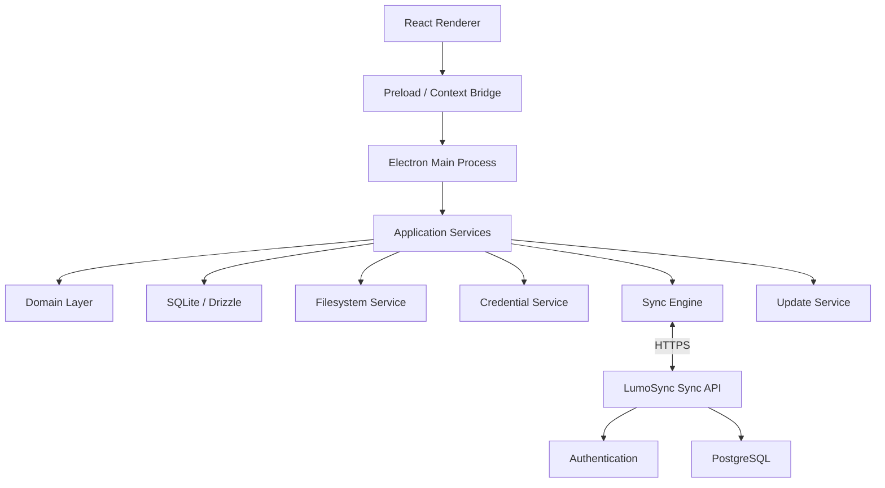
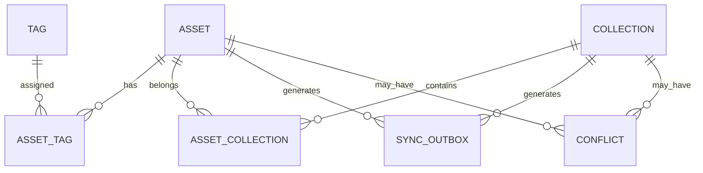
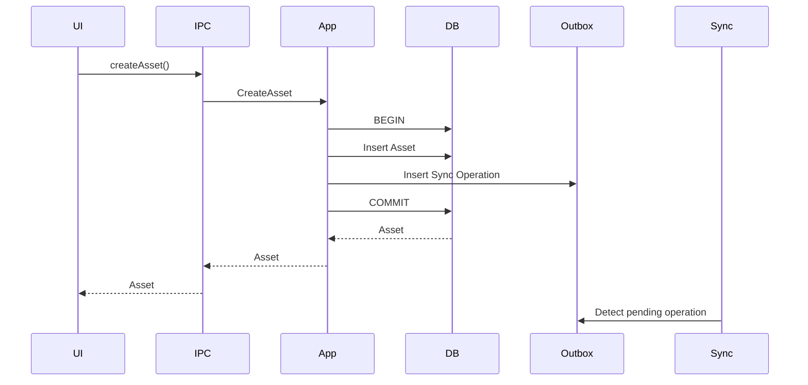
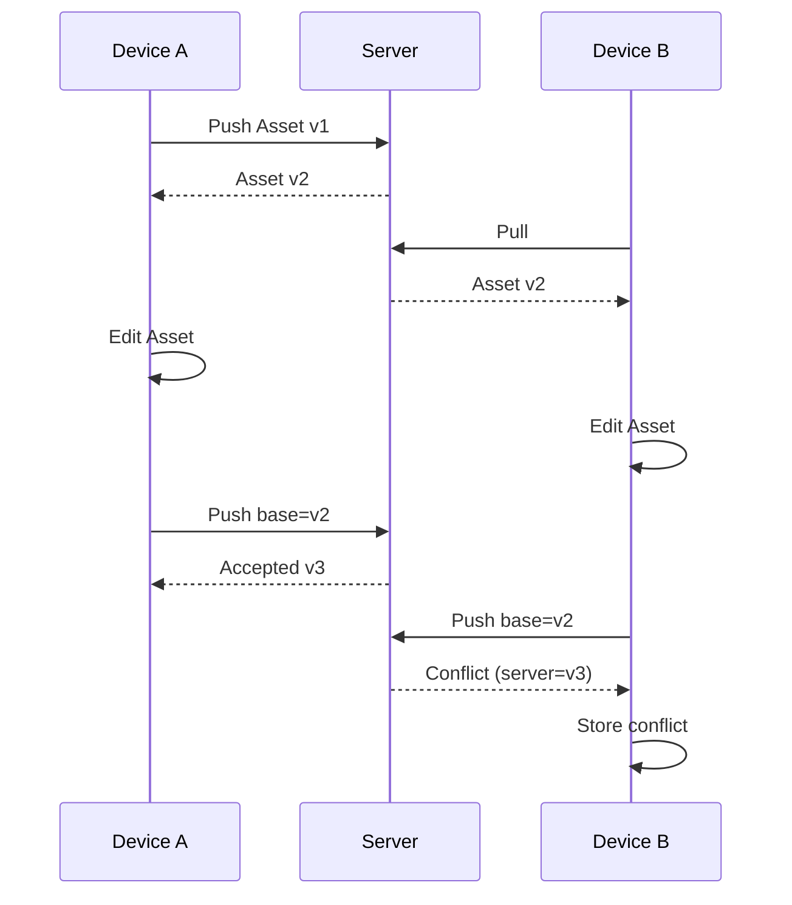

# LumoSync — Technical Design Document (TDD)

**Document Version:** 1.0
**Status:** Proposed
**Product:** LumoSync — Local-First Code & Asset Manager
**Primary Platforms:** Windows, macOS, Linux
**Primary Stack:** Electron, React, TypeScript, SQLite

---

## 1. Purpose

This Technical Design Document defines the architecture and implementation approach for LumoSync.

The PRD describes **what LumoSync should do**. This document defines **how it will be built**.

The primary architectural goal is:

> **LumoSync must remain a fully functional local application even when the network and synchronization service are unavailable.**

The remote service exists to synchronize trusted devices, not to sit between the user and their local data.

---

# 2. Technical Goals

The implementation must provide:

1. Fast local-first asset management.
2. Reliable offline operation.
3. Persistent synchronization queues.
4. Deterministic synchronization behavior.
5. Safe conflict detection and resolution.
6. Secure Electron process boundaries.
7. Cross-platform filesystem and credential handling.
8. Automatic application updates.
9. Testable domain and infrastructure layers.
10. A codebase that can later support CLI and IDE integrations.

---

# 3. Architectural Decisions

| Area                   | Decision                                    |
| ---------------------- | ------------------------------------------- |
| Desktop runtime        | Electron                                    |
| UI                     | React + TypeScript                          |
| Renderer bundler       | Vite                                        |
| Styling                | Tailwind CSS + shadcn/ui                    |
| Renderer state         | Zustand                                     |
| Async data/cache       | TanStack Query                              |
| Local database         | SQLite                                      |
| SQLite driver          | `better-sqlite3`                            |
| Local ORM/query layer  | Drizzle ORM                                 |
| Validation             | Zod                                         |
| IPC                    | Electron `contextBridge` + `ipcMain.handle` |
| Local credentials      | Electron `safeStorage`                      |
| Backend                | Next.js                                     |
| API                    | REST/JSON                                   |
| Server database        | PostgreSQL                                  |
| Server ORM             | Drizzle ORM                                 |
| Authentication         | Better Auth                                 |
| Application logging    | Pino                                        |
| Unit/integration tests | Vitest                                      |
| Desktop E2E            | Playwright                                  |
| Packaging              | electron-builder                            |
| Auto-update            | electron-updater                            |
| Package manager        | pnpm                                        |
| Monorepo               | pnpm workspace + Turborepo                  |
| ID format              | UUIDv7                                      |

The stack deliberately keeps the core application TypeScript-based. This allows the desktop application, synchronization contracts, domain types, validation schemas, and backend to share types without introducing another language/runtime.

---

# 4. High-Level Architecture



The renderer never communicates directly with SQLite, the filesystem, credentials, or the synchronization service.

---

# 5. Process Architecture

Electron provides three important boundaries.

## 5.1 Renderer Process

The renderer behaves like a normal web application.

Responsibilities:

* rendering UI
* local UI state
* search input
* forms
* dialogs
* command palette
* displaying synchronization status
* requesting operations through the preload bridge

The renderer must **not**:

* access Node.js directly
* access SQLite directly
* read arbitrary files
* store authentication credentials
* make privileged filesystem calls
* invoke unrestricted shell commands

---

## 5.2 Preload Process

The preload layer is the explicit security boundary between React and Electron.

It exposes a typed API such as:

```ts
window.lumosync.assets.create(...)
window.lumosync.assets.update(...)
window.lumosync.assets.delete(...)
window.lumosync.assets.search(...)
window.lumosync.sync.getStatus()
window.lumosync.system.openFile(...)
```

No generic API such as this should exist:

```ts
window.lumosync.fs.readFile(...)
```

Instead, capabilities should be narrowly scoped.

---

## 5.3 Main Process

The Electron main process owns privileged functionality.

Responsibilities:

* application lifecycle
* BrowserWindow creation
* IPC handlers
* SQLite connection
* filesystem access
* secure storage
* synchronization engine
* network requests
* auto-update management
* application logging
* OS integration

---

# 6. Monorepo Structure

Recommended repository:

```text
lumosync/
│
├── apps/
│   │
│   ├── desktop/
│   │   ├── src/
│   │   │   ├── main/
│   │   │   ├── preload/
│   │   │   └── renderer/
│   │   │
│   │   ├── electron-builder.yml
│   │   ├── vite.config.ts
│   │   └── package.json
│   │
│   └── sync-api/
│       ├── src/
│       │   ├── app/
│       │   ├── modules/
│       │   ├── db/
│       │   └── lib/
│       └── package.json
│
├── packages/
│   │
│   ├── contracts/
│   │   ├── src/
│   │   │   ├── assets.ts
│   │   │   ├── sync.ts
│   │   │   ├── devices.ts
│   │   │   └── errors.ts
│   │   └── package.json
│   │
│   ├── domain/
│   │   ├── src/
│   │   │   ├── assets/
│   │   │   ├── collections/
│   │   │   ├── sync/
│   │   │   └── devices/
│   │   └── package.json
│   │
│   └── config/
│       ├── eslint/
│       ├── tsconfig/
│       └── package.json
│
├── docs/
│   ├── PRD.md
│   ├── TDD.md
│   ├── ADR/
│   └── diagrams/
│
├── package.json
├── pnpm-workspace.yaml
├── turbo.json
└── README.md
```

---

# 7. Application Layer Architecture

The desktop application should be organized into four logical layers.

```text
Presentation
      ↓
Application
      ↓
Domain
      ↓
Infrastructure
```

## Presentation

React components and hooks.

```text
AssetList
AssetEditor
AssetViewer
CollectionSidebar
SearchCommand
SyncStatus
ConflictDialog
Settings
```

## Application

Use cases.

```text
CreateAsset
UpdateAsset
DeleteAsset
SearchAssets
CopyAsset
CreateCollection
UpdateCollection
QueueSyncOperation
RunSync
ResolveConflict
RegisterDevice
```

## Domain

Business rules.

```text
Asset
Collection
Tag
SyncOperation
SyncConflict
Device
```

## Infrastructure

Concrete implementations.

```text
SQLiteAssetRepository
SQLiteCollectionRepository
SQLiteSyncRepository
FilesystemService
SecureStorageService
SyncApiClient
UpdaterService
```

This prevents React components from containing business logic.

---

# 8. Domain Model

## 8.1 Asset

```ts
type Asset = {
  id: string
  title: string
  description: string | null
  content: string
  assetType: AssetType
  language: string | null

  collectionIds: string[]
  tags: string[]

  isFavorite: boolean
  createdAt: Date
  updatedAt: Date
  lastUsedAt: Date | null
  deletedAt: Date | null

  syncState: SyncState
  remoteVersion: number | null
}
```

---

## 8.2 Asset Types

```ts
enum AssetType {
  CODE = "code",
  COMMAND = "command",
  CONFIG = "config",
  NOTE = "note",
  TEMPLATE = "template"
}
```

Binary file assets will be supported by the architecture, but **binary synchronization is not part of the first synchronization implementation**.

The MVP sync protocol will focus on text/code content.

This keeps the first version of sync deterministic and significantly easier to test.

---

# 9. Collection Model

```ts
type Collection = {
  id: string
  name: string
  description: string | null
  createdAt: Date
  updatedAt: Date
  deletedAt: Date | null

  syncState: SyncState
  remoteVersion: number | null
}
```

---

# 10. Sync State

```ts
enum SyncState {
  SYNCED = "synced",
  PENDING = "pending",
  SYNCING = "syncing",
  CONFLICT = "conflict",
  FAILED = "failed"
}
```

An asset does not need to wait for synchronization before being usable.

---

# 11. Local Database

SQLite is the application's primary persistence layer.

The database is located under the OS-specific application data directory.

Conceptually:

```text
LumoSync Application Data/
│
├── data/
│   └── lumosync.sqlite
│
├── assets/
├── imports/
├── exports/
├── logs/
└── cache/
```

The actual location must be resolved using Electron's `app.getPath("userData")`.

---

# 12. SQLite Schema

## `assets`

```text
id
title
description
content
asset_type
language
is_favorite

created_at
updated_at
last_used_at
deleted_at

sync_state
remote_version
base_remote_version
```

---

## `collections`

```text
id
name
description

created_at
updated_at
deleted_at

sync_state
remote_version
base_remote_version
```

---

## `tags`

```text
id
name
created_at
```

---

## `asset_tags`

```text
asset_id
tag_id
```

Unique constraint:

```text
(asset_id, tag_id)
```

---

## `asset_collections`

```text
asset_id
collection_id
```

Unique constraint:

```text
(asset_id, collection_id)
```

---

## `sync_outbox`

The outbox contains local mutations that have not been successfully acknowledged by the server.

```text
id
operation_id
entity_type
entity_id

operation
payload

base_remote_version

created_at
attempt_count
last_attempt_at
last_error
```

---

## `sync_state`

```text
id
device_id
pull_cursor

last_successful_sync_at
last_sync_attempt_at

sync_status
last_error
```

There will normally be one active row per device.

---

## `conflicts`

```text
id

entity_type
entity_id

local_snapshot
remote_snapshot

local_base_version
remote_version

created_at
resolved_at
resolution
```

---

# 13. Database Relationships



---

# 14. Database Migrations

All schema changes must be versioned.

Example:

```text
drizzle/
├── 0001_initial_schema.sql
├── 0002_add_sync_state.sql
├── 0003_add_conflicts.sql
└── 0004_add_last_used_at.sql
```

The application must run pending migrations automatically during startup.

Migration failure is a critical startup error.

The application must not silently continue using an outdated schema.

---

# 15. Local Transaction Rules

Local mutations should be atomic.

For example, creating an asset requires:

```text
BEGIN TRANSACTION

INSERT asset
INSERT tags
INSERT asset_tags
INSERT sync_outbox

COMMIT
```

The application must never reach this state:

```text
Asset exists
but
Sync operation does not exist
```

The transactional outbox guarantees that every local synchronized mutation produces a persistent sync operation.

---

# 16. Local-First Data Flow

Creating an asset:



The user receives the new asset without waiting for the network.

---

# 17. Sync Architecture

The sync engine runs independently of the renderer.

```text
                   ┌───────────────┐
                   │ Local SQLite  │
                   └───────┬───────┘
                           │
                    Pending Operations
                           │
                           ▼
                   ┌───────────────┐
                   │  Sync Engine  │
                   └───────┬───────┘
                           │
                     HTTPS / JSON
                           │
                           ▼
                   ┌───────────────┐
                   │   Sync API    │
                   └───────┬───────┘
                           │
                           ▼
                   ┌───────────────┐
                   │  PostgreSQL   │
                   └───────────────┘
```

---

# 18. Sync Engine Responsibilities

The sync engine is responsible for:

* checking whether synchronization is necessary
* reading outbox operations
* pulling remote changes
* pushing local changes
* tracking cursors
* handling retries
* detecting conflicts
* updating synchronization state
* reporting progress
* preventing concurrent sync runs

The renderer should never control individual sync requests directly.

---

# 19. Sync Scheduling

The engine should synchronize:

### On application startup

```text
Application ready
↓
Load sync state
↓
Run sync
```

### When connectivity becomes available

```text
Network recovery
↓
Trigger sync
```

### After local mutation

```text
Asset changed
↓
Queue operation
↓
Schedule background sync
```

### Periodically

For example:

```text
Every 1–5 minutes
```

The exact interval should be configurable.

---

# 20. Concurrency Control

Only one sync job may run for a device at a time.

```ts
if (syncInProgress) {
  return;
}

syncInProgress = true;

try {
  await runSync();
} finally {
  syncInProgress = false;
}
```

Multiple triggers should collapse into a single pending synchronization.

---

# 21. Sync Protocol

The synchronization protocol will use **incremental change synchronization**.

The server maintains a monotonically increasing change sequence.

Example:

```text
Change #1001
Change #1002
Change #1003
Change #1004
```

The device stores:

```text
pull_cursor = 1002
```

The next pull asks for:

```text
changes after 1002
```

---

# 22. Push Operation

Example request:

```http
POST /api/v1/sync/push
```

```json
{
  "deviceId": "device-uuid",
  "operations": [
    {
      "operationId": "op-uuid",
      "entityType": "asset",
      "entityId": "asset-uuid",
      "operation": "update",
      "baseRemoteVersion": 4,
      "payload": {
        "title": "Docker Cleanup",
        "content": "docker system prune",
        "tags": ["docker", "cleanup"]
      }
    }
  ]
}
```

---

# 23. Pull Operation

```http
GET /api/v1/sync/pull?cursor=1002
```

Response:

```json
{
  "changes": [
    {
      "sequence": 1003,
      "entityType": "asset",
      "entityId": "asset-uuid",
      "operation": "update",
      "version": 5,
      "payload": {}
    }
  ],
  "nextCursor": 1003
}
```

---

# 24. Sync Algorithm

The recommended synchronization cycle is:

```text
START
  │
  ▼
Acquire sync lock
  │
  ▼
Pull changes since cursor
  │
  ▼
Apply safe remote changes
  │
  ├── Conflict? ──► Store conflict
  │
  ▼
Read pending outbox operations
  │
  ▼
Push operations
  │
  ├── Accepted ──► Mark synced
  │
  ├── Conflict ──► Store conflict
  │
  └── Error ──► Retry later
  │
  ▼
Pull again
  │
  ▼
Advance cursor
  │
  ▼
Release sync lock
```

The second pull ensures the device sees changes generated as part of the push cycle.

---

# 25. Version-Based Conflict Detection

Every synchronized entity has a server-side version.

Example:

```text
Server:
Asset A = version 7
```

Device A loads version 7.

Device B loads version 7.

Device A updates:

```text
7 → 8
```

Device B attempts:

```text
base version = 7
```

The server sees:

```text
current server version = 8
base version = 7
```

Therefore:

```text
CONFLICT
```

The server must not silently overwrite version 8.

---

# 26. Conflict States

```text
SYNCED
   │
   ▼
EDITED
   │
   ▼
PENDING
   │
   ├──────────────┐
   │              │
   ▼              ▼
SYNCED         CONFLICT
                  │
        ┌─────────┼─────────┐
        ▼         ▼         ▼
      Keep      Keep       Merge
      Local     Remote
```

---

# 27. Conflict Storage

A conflict must contain enough information for the user to recover.

Example:

```json
{
  "entityId": "asset-123",
  "localSnapshot": {},
  "remoteSnapshot": {},
  "localBaseVersion": 4,
  "remoteVersion": 5
}
```

The conflict should remain until the user explicitly resolves it.

---

# 28. Conflict Resolution

## Keep Local

Create a new update based on the latest remote version.

```text
Remote version = 8

Local desired state
+
baseRemoteVersion = 8

→ push as version 9
```

---

## Keep Remote

Replace the local snapshot with the remote version.

No additional local mutation needs to be pushed.

---

## Merge

The user manually creates the desired combined content.

The resulting asset is then pushed against the latest remote version.

---

# 29. Delete Semantics

Deletes are represented as tombstones.

Instead of:

```sql
DELETE FROM assets;
```

the synchronized entity receives:

```text
deleted_at = timestamp
```

This prevents an offline device from accidentally resurrecting deleted data.

Tombstones should remain available for synchronization until the application has an explicit garbage-collection strategy.

For MVP, keeping them indefinitely is acceptable because the metadata footprint is small.

---

# 30. Sync API Architecture

The backend will be a lightweight API rather than a second application frontend.

Suggested structure:

```text
apps/sync-api/

src/
├── app/
│   └── api/
│       └── v1/
│           ├── auth/
│           ├── devices/
│           └── sync/
│
├── modules/
│   ├── auth/
│   ├── devices/
│   ├── sync/
│   └── assets/
│
├── db/
│   ├── schema/
│   └── migrations/
│
└── lib/
    ├── auth/
    ├── validation/
    └── errors/
```

---

# 31. Server Data Model

The backend requires:

```text
users
devices
assets
collections
sync_changes
```

## `devices`

```text
id
user_id
name
platform
last_seen_at
created_at
revoked_at
```

## `assets`

```text
id
user_id
title
description
content
asset_type
language
tags
collection_ids

version
created_at
updated_at
deleted_at
```

The server stores the authoritative synchronized snapshot.

---

# 32. Change Log

The `sync_changes` table is central to incremental synchronization.

```text
sequence
user_id

entity_type
entity_id

operation
version

payload

created_at
```

`sequence` should be monotonically increasing.

A device's cursor points to the last fully applied sequence.

---

# 33. Idempotency

Every synchronization operation receives a unique:

```text
operationId
```

The server must record processed operation IDs.

If a request is retried:

```text
same operationId
```

the server should return the previously determined result rather than applying the operation twice.

This is critical for network retry behavior.

---

# 34. Authentication

Authentication is handled by the backend.

The desktop application should not persist raw passwords.

Authentication flow:

```text
User
 │
 ▼
Desktop Login
 │
 ▼
Sync API
 │
 ▼
Authentication Service
 │
 ▼
Session / Tokens
 │
 ▼
Electron Secure Storage
```

Credentials/tokens are stored using Electron's secure storage facilities.

---

# 35. Secure Credential Storage

Use Electron `safeStorage`.

The renderer never sees the underlying stored credential after the application has moved it into the secure main-process layer.

Conceptually:

```text
React
  │
  │ authenticate()
  ▼
Main Process
  │
  ▼
Auth API
  │
  ▼
Token
  │
  ▼
safeStorage.encryptString()
  │
  ▼
OS Credential Storage
```

The actual token must not be persisted in:

* SQLite
* localStorage
* IndexedDB
* plaintext JSON configuration
* renderer memory longer than necessary

---

# 36. Electron Security Configuration

The production BrowserWindow should use:

```ts
webPreferences: {
  preload,
  contextIsolation: true,
  nodeIntegration: false,
  sandbox: true,
  webSecurity: true
}
```

Additional restrictions:

* prevent unauthorized navigation
* restrict new windows
* validate IPC arguments
* use Content Security Policy
* never expose arbitrary `ipcRenderer`
* never expose arbitrary filesystem functions
* never evaluate remote JavaScript
* never load arbitrary remote applications into the main window

---

# 37. IPC Architecture

IPC channels should be domain-scoped.

Example:

```text
asset:create
asset:update
asset:delete
asset:get
asset:list
asset:search

collection:create
collection:update
collection:delete
collection:list

sync:get-status
sync:trigger
sync:get-conflicts

settings:get
settings:update
```

Avoid generic channels such as:

```text
execute
command
filesystem
database
```

---

# 38. IPC Contract

Each IPC method should have:

1. typed request
2. runtime validation
3. domain call
4. typed response
5. normalized error handling

Example:

```ts
const createAssetSchema = z.object({
  title: z.string().min(1).max(200),
  content: z.string(),
  assetType: z.enum([
    "code",
    "command",
    "config",
    "note",
    "template"
  ]),
  language: z.string().nullable(),
  description: z.string().nullable(),
  tags: z.array(z.string()),
  collectionIds: z.array(z.string())
});
```

---

# 39. Shared Contract Package

The following types should live in:

```text
packages/contracts
```

Examples:

```ts
CreateAssetRequest
CreateAssetResponse
UpdateAssetRequest
SyncPushRequest
SyncPushResponse
SyncPullResponse
ConflictResponse
DeviceResponse
ApiError
```

This prevents the Electron app and API from independently defining the same protocol.

---

# 40. Repository Pattern

Database access should be isolated.

Example:

```ts
interface AssetRepository {
  create(asset: Asset): Promise<Asset>
  findById(id: string): Promise<Asset | null>
  update(asset: Asset): Promise<Asset>
  delete(id: string): Promise<void>
  search(query: string): Promise<Asset[]>
}
```

The domain/application layer should not know that SQLite exists.

---

# 41. Filesystem Service

Filesystem functionality should be wrapped.

Example:

```ts
interface FileStorage {
  save(path: string, data: Buffer): Promise<void>
  read(path: string): Promise<Buffer>
  delete(path: string): Promise<void>
  exists(path: string): Promise<boolean>
}
```

The service must enforce a controlled root directory.

Paths received from the renderer must never be allowed to escape that directory.

---

# 42. Search Architecture

SQLite FTS5 should be used for local full-text search.

Searchable fields:

```text
title
description
content
tags
```

Example:

```text
fts_assets
```

Search should support:

```text
docker cleanup
nginx proxy
spring security
jwt
```

The search index should be updated within the same transaction as the asset mutation where practical.

---

# 43. Search Ranking

Results should be ranked approximately:

```text
Title match
   ↓
Tag match
   ↓
Description match
   ↓
Content match
```

Exact title matches should appear before broad content matches.

---

# 44. Renderer State Management

Use Zustand for application/UI state.

Example stores:

```text
sessionStore
navigationStore
editorStore
preferencesStore
syncStore
```

TanStack Query can manage asynchronous IPC-backed queries where caching and invalidation are useful.

The database remains the source of persisted local state.

---

# 45. UI Data Flow

```text
React Component
      │
      ▼
Query / Mutation Hook
      │
      ▼
window.lumosync
      │
      ▼
Preload
      │
      ▼
IPC
      │
      ▼
Application Service
      │
      ▼
Repository
      │
      ▼
SQLite
```

React state should never be treated as the permanent data source.

---

# 46. Application Startup

Startup sequence:

```text
Electron starts
      ↓
Load environment/config
      ↓
Initialize logger
      ↓
Initialize secure storage
      ↓
Open SQLite
      ↓
Run migrations
      ↓
Initialize repositories
      ↓
Initialize synchronization engine
      ↓
Register IPC handlers
      ↓
Create BrowserWindow
      ↓
Load React application
      ↓
Trigger background sync
```

A database migration failure should prevent the application from entering normal operation.

---

# 47. Application Shutdown

Before shutdown:

```text
Stop accepting new sync jobs
        ↓
Complete active DB transaction
        ↓
Persist pending state
        ↓
Close SQLite
        ↓
Flush logs
        ↓
Exit
```

The outbox ensures unsent changes remain available after restart.

---

# 48. Auto-Update Architecture

Use:

```text
electron-builder
+
electron-updater
```

Update lifecycle:

```text
Application starts
        ↓
Check release metadata
        ↓
Update available?
     /       \
   No        Yes
   │          │
Continue   Download
              │
              ▼
           Verify
              │
              ▼
        Install on restart
```

Updates must never delete or replace:

```text
database
user assets
sync queue
credentials
configuration
```

---

# 49. Crash Recovery

SQLite should use a journal mode suitable for desktop reliability, with WAL enabled where appropriate.

The application must assume crashes can occur during:

* asset writes
* synchronization
* migrations
* updates

Every critical multi-step operation must therefore be transactionally safe.

---

# 50. Logging

Use structured logging.

Example:

```json
{
  "level": "info",
  "event": "sync.completed",
  "deviceId": "device-123",
  "pushed": 4,
  "pulled": 7,
  "conflicts": 1
}
```

Logging must never include:

* passwords
* access tokens
* refresh tokens
* encryption keys
* complete sensitive asset contents

---

# 51. Error Model

Errors should use stable error codes.

Example:

```ts
enum ErrorCode {
  VALIDATION_ERROR = "VALIDATION_ERROR",
  ASSET_NOT_FOUND = "ASSET_NOT_FOUND",
  DATABASE_ERROR = "DATABASE_ERROR",
  AUTH_REQUIRED = "AUTH_REQUIRED",
  NETWORK_ERROR = "NETWORK_ERROR",
  SYNC_CONFLICT = "SYNC_CONFLICT",
  SYNC_FAILED = "SYNC_FAILED",
  STORAGE_ERROR = "STORAGE_ERROR"
}
```

IPC and API errors should map to the same general error vocabulary.

---

# 52. Offline Behavior

When offline:

```text
CREATE
UPDATE
DELETE
SEARCH
COPY
IMPORT
EXPORT
```

must continue working.

Only synchronization should fail or pause.

Example:

```text
Internet unavailable

Local changes:
✓ Saved

Synchronization:
○ 3 changes waiting
```

---

# 53. Network Failure Strategy

The sync engine must use exponential backoff.

Example:

```text
Attempt 1 → immediate
Attempt 2 → 2 sec
Attempt 3 → 4 sec
Attempt 4 → 8 sec
Attempt 5 → 16 sec
...
```

A configurable maximum interval should prevent excessive network activity.

After repeated failures:

```text
Sync paused
```

The next user action or periodic trigger can resume synchronization.

---

# 54. Sync Status Events

The main process should notify the renderer about status changes.

Example:

```text
sync:status-changed
```

Payload:

```ts
{
  state: "syncing",
  pending: 3,
  conflicts: 1,
  lastSyncedAt: "..."
}
```

This allows the UI to update without repeatedly polling the database.

---

# 55. Import/Export

MVP formats:

```text
JSON
Markdown
```

Export example:

```text
LumoSync Export
├── assets/
├── collections/
└── manifest.json
```

The manifest should include:

```text
exportVersion
createdAt
applicationVersion
```

Imports must be schema-validated before modifying the local database.

---

# 56. Security Threat Model

## Renderer compromise

Risk:

```text
XSS
↓
Malicious renderer code
↓
Attempts privileged access
```

Mitigation:

* context isolation
* sandbox
* no Node integration
* minimal preload API
* CSP
* typed IPC
* validation

---

## Malicious Asset Content

A code snippet can contain:

```html
<script>
...
</script>
```

Asset content must therefore be treated as **data**, not HTML.

Syntax highlighting must escape content before rendering.

Never inject asset content using unsafe HTML APIs.

---

## Path Traversal

An imported path such as:

```text
../../../../important-file
```

must never be trusted.

All filesystem paths must resolve beneath approved directories.

---

## Credential Theft

Mitigation:

* secure OS storage
* no tokens in SQLite
* no tokens in logs
* minimal token lifetime
* device revocation
* logout invalidation

---

## Update Tampering

Production release artifacts should be signed.

The application should reject invalid update signatures.

---

# 57. Testing Strategy

Testing should occur at four levels.

```text
Unit
  ↓
Integration
  ↓
Sync/System
  ↓
End-to-End
```

---

# 58. Unit Tests

Unit tests cover pure logic.

Examples:

```text
Asset validation
Tag normalization
Search query construction
Conflict detection
Sync state transitions
Retry calculation
Version comparison
```

Example:

```ts
describe("conflict detection", () => {
  it("detects stale base version", () => {
    expect(
      isConflict({
        localBaseVersion: 4,
        remoteVersion: 5
      })
    ).toBe(true)
  })
})
```

---

# 59. Repository Integration Tests

Use a temporary SQLite database.

Test:

```text
Create asset
Read asset
Update asset
Delete asset
Search asset
Transactions
Migrations
Outbox insertion
Conflict persistence
```

Important test:

```text
Given asset creation succeeds
Then corresponding outbox operation exists
```

---

# 60. Sync Integration Tests

A mock API should simulate:

* successful push
* successful pull
* timeout
* authentication failure
* duplicate operation
* stale version
* server error
* reordered responses

Example:

```text
Device A
   ↓
Push asset
   ↓
Server version 2

Device B
   ↓
Push stale version 1
   ↓
Conflict
```

---

# 61. End-to-End Tests

Use Playwright against a packaged or test-mode Electron application.

Critical flows:

### Asset lifecycle

```text
Launch
→ Create asset
→ Search
→ Open
→ Edit
→ Copy
→ Delete
```

### Offline lifecycle

```text
Launch
→ Disable network
→ Create asset
→ Restart
→ Verify asset
→ Restore network
→ Sync
```

### Multi-device

```text
Device A creates asset
→ Sync
→ Device B pulls
→ Asset exists
```

### Conflict

```text
Both devices edit same asset
→ Both synchronize
→ Conflict appears
→ User resolves
→ Devices converge
```

---

# 62. Testing the Local-First Guarantee

This deserves an explicit acceptance test.

```text
Network = unavailable

Create asset
Update asset
Delete asset
Search
Copy
Restart application
```

Expected:

```text
All operations succeed locally.
```

This is one of the most important characteristics of the product.

---

# 63. Performance Strategy

The application should avoid loading every asset into React state.

For large libraries:

```text
SQLite
   ↓
Pagination / FTS
   ↓
Small result set
   ↓
Renderer
```

The UI should load:

```text
Asset summary
```

first, and retrieve full content when required.

---

# 64. Large Content Handling

Normal snippets should remain directly in SQLite.

For unusually large content:

```text
metadata → SQLite
body → filesystem
```

A future threshold can determine when content moves out of SQLite.

Binary assets will use filesystem-backed storage.

---

# 65. Memory Management

The renderer should not maintain:

```text
all assets
+
all asset content
```

simultaneously for large libraries.

Instead:

* virtualized asset lists
* paginated queries
* selected-asset loading
* query cache expiration
* content cleanup when changing assets

---

# 66. Keyboard Shortcuts

Initial shortcuts:

| Shortcut               | Action          |
| ---------------------- | --------------- |
| `Ctrl/Cmd + K`         | Global search   |
| `Ctrl/Cmd + N`         | New asset       |
| `Ctrl/Cmd + Enter`     | Save asset      |
| `Ctrl/Cmd + Shift + C` | Copy asset      |
| `Ctrl/Cmd + Shift + F` | Toggle favorite |
| `Ctrl/Cmd + ,`         | Settings        |

Platform-specific modifier handling should use Electron's menu/shortcut abstraction.

---

# 67. Developer Command Palette

The command palette should expose operations such as:

```text
Create Asset
Search Assets
Open Favorites
Open Recent
Create Collection
Trigger Sync
View Conflicts
Export Library
Open Settings
Check for Updates
```

The command palette should invoke application commands rather than directly manipulating state.

---

# 68. Configuration

Application configuration should be separated into:

### User settings

```text
theme
font size
editor preferences
sync interval
startup behavior
```

### System configuration

```text
API URL
app environment
logging level
release channel
```

Production secrets must never be bundled into the renderer.

---

# 69. Environments

Three environments:

```text
development
staging
production
```

Example:

```text
LUMOSYNC_API_URL
LUMOSYNC_ENV
```

The API endpoint must not be hardcoded throughout the application.

---

# 70. CI/CD

GitHub Actions should run:

```text
Pull Request
    ↓
Install
    ↓
Lint
    ↓
Typecheck
    ↓
Unit Tests
    ↓
Integration Tests
    ↓
Build
```

Release pipeline:

```text
Tag Release
     ↓
Build Windows
Build macOS
Build Linux
     ↓
Sign artifacts
     ↓
Publish release
     ↓
Generate update metadata
```

---

# 71. Cross-Platform Build Matrix

```yaml
os:
  - windows
  - macos
  - linux
```

Each release should produce installable artifacts for the supported platforms.

---

# 72. Packaging Targets

Initial targets:

### Windows

```text
NSIS installer
```

### macOS

```text
DMG
```

### Linux

```text
AppImage
```

Additional Linux packages may be added later.

---

# 73. Observability

MVP observability should be local-first as well.

The application should maintain:

```text
application.log
sync.log
error.log
```

A diagnostics screen may expose:

```text
Application version
OS
Database version
Last sync
Pending changes
Conflict count
Device ID
```

Sensitive content should not be included.

---

# 74. Domain Events

The application can use an internal event bus to decouple components.

Examples:

```text
asset.created
asset.updated
asset.deleted

sync.started
sync.completed
sync.failed
sync.conflict

device.registered
device.revoked
```

Example:

```text
AssetUpdated
      ↓
EventBus
      ├── Sync Queue
      ├── Activity Tracking
      └── UI Notification
```

The event bus is internal and must not replace transaction boundaries.

Database transaction success must come before publishing a durable event.

---

# 75. Event Handling Rule

The implementation should avoid this unsafe pattern:

```text
Publish event
↓
Database write
```

Instead:

```text
Database transaction
↓
Commit
↓
Publish/invoke downstream work
```

For synchronization, the durable outbox is the actual source of truth.

---

# 76. Dependency Rules

The architecture should enforce:

```text
Renderer
  ↓
Application interfaces
  ↓
Domain

Infrastructure
  ↓
Domain/Application interfaces
```

The renderer must never import:

```text
better-sqlite3
fs
path
net
electron
```

directly.

---

# 77. API Error Handling

The server should return consistent responses.

Example:

```json
{
  "success": false,
  "error": {
    "code": "SYNC_CONFLICT",
    "message": "The asset has changed on another device."
  }
}
```

The desktop client maps API errors to domain-level errors.

---

# 78. Sync Conflict Example



---

# 79. Device Registration

Device registration should generate a unique local identifier.

Example:

```text
deviceId = UUIDv7
```

Device metadata:

```text
id
name
platform
appVersion
createdAt
lastSeenAt
```

The device ID should persist across application restarts.

Uninstall/reinstall behavior may generate a new device identity unless device restoration is explicitly implemented later.

---

# 80. Device Revocation

When a user revokes a device:

```text
Server marks device revoked
↓
Existing credentials become invalid
↓
Device can no longer sync
↓
Local assets remain available
```

Importantly, revocation does **not** delete local user data.

The local database remains the user's local copy.

---

# 81. Logout

Logout should:

1. stop synchronization
2. revoke/clear local session credentials
3. clear auth state
4. retain local library by default

The user may optionally choose:

```text
Keep local library
```

or:

```text
Remove local library
```

The second action must require explicit confirmation.

---

# 82. Data Ownership Principle

LumoSync must never interpret account logout as permission to destroy local developer assets.

Therefore:

```text
Logout ≠ Delete Data
```

This distinction is fundamental to the local-first architecture.

---

# 83. Future Binary Asset Architecture

When file assets are introduced:

```text
Asset Metadata
     ↓
SQLite

Binary Content
     ↓
Filesystem
     ↓
SHA-256 Content Hash
     ↓
Sync Service
```

The sync payload can reference:

```text
contentHash
size
mimeType
```

Content transfer can then use a separate upload/download mechanism.

This should not be introduced until text synchronization is stable.

---

# 84. Future Semantic Search

The search architecture should leave room for:

```text
Traditional FTS5
+
Embedding index
```

Future query:

```text
"reverse proxy configuration"
```

could retrieve:

```text
nginx reverse proxy
apache proxy config
tomcat proxy setup
```

This is deliberately outside the MVP.

---

# 85. Future CLI Architecture

Because domain/application logic is separated from Electron, a future CLI can reuse it.

Potential future structure:

```text
CLI
 │
 ▼
Application Layer
 │
 ▼
SQLite
```

Example:

```bash
lumosync search "docker cleanup"
lumosync copy "docker cleanup"
lumosync add
lumosync sync
```

No Electron renderer would be required.

---

# 86. Architecture Decision Records

The project should maintain ADRs for major technical choices.

Initial ADRs:

```text
ADR-001 Electron for desktop runtime
ADR-002 SQLite as local persistence
ADR-003 Local database as primary source for UX
ADR-004 Transactional outbox for sync
ADR-005 Version-based conflict detection
ADR-006 Electron safeStorage for credentials
ADR-007 REST-based synchronization protocol
ADR-008 Monorepo architecture
ADR-009 Text-first synchronization MVP
ADR-010 Electron builder for distribution
```

---

# 87. Important Architectural Constraint

The following rule should be treated as a core invariant:

> **No user-facing asset operation may require the synchronization API.**

Therefore:

```text
Create Asset      → Local only
Edit Asset        → Local only
Delete Asset      → Local only
Search Asset      → Local only
Copy Asset        → Local only
Organize Asset    → Local only
```

Synchronization happens afterward.

---

# 88. Core Invariants

The following must always be true.

### Invariant 1

Every successful synchronized local mutation has a corresponding outbox operation.

### Invariant 2

An outbox operation can safely be retried.

### Invariant 3

A stale write cannot silently overwrite newer remote data.

### Invariant 4

A deleted synchronized asset cannot unexpectedly reappear because another device was offline.

### Invariant 5

Renderer code cannot directly access privileged system resources.

### Invariant 6

Logging cannot expose authentication secrets.

### Invariant 7

Application updates cannot destroy local user data.

---

# 89. Implementation Phases

## Phase 1 — Repository Foundation

Build:

```text
Monorepo
Electron
Vite
React
TypeScript
Tailwind
shadcn/ui
ESLint
Prettier
Vitest
Playwright
CI
```

Deliverable:

> Secure cross-platform desktop shell.

---

## Phase 2 — Electron Security Boundary

Build:

```text
Main process
Preload
Context bridge
IPC contracts
Security configuration
Logger
Application configuration
```

Deliverable:

> Secure renderer → native process architecture.

---

## Phase 3 — SQLite Data Layer

Build:

```text
Drizzle
SQLite
Migrations
Repositories
Transactions
Asset model
Collection model
Tag model
```

Deliverable:

> Fully persistent local database.

---

## Phase 4 — Asset Manager

Build:

```text
Asset CRUD
Collections
Tags
Favorites
Recent
Clipboard
Search
Command palette
```

Deliverable:

> Useful offline developer asset application with zero networking.

This is an important milestone and should be fully usable before synchronization is introduced.

---

## Phase 5 — Authentication

Build:

```text
Backend
PostgreSQL
Better Auth
Device registration
Session management
Secure token storage
```

Deliverable:

> A device can securely authenticate.

---

## Phase 6 — Sync Backend

Build:

```text
sync_changes
server versions
push endpoint
pull endpoint
idempotency
device cursors
```

Deliverable:

> Two authenticated devices can synchronize simple assets.

---

## Phase 7 — Desktop Sync Engine

Build:

```text
Outbox
Sync worker
Retries
Pull cursor
Status reporting
Offline queue
```

Deliverable:

> Reliable background synchronization.

---

## Phase 8 — Conflict Resolution

Build:

```text
Conflict detection
Conflict persistence
Conflict UI
Keep Local
Keep Remote
Manual Merge
```

Deliverable:

> Concurrent changes cannot silently overwrite each other.

---

## Phase 9 — Packaging & Updates

Build:

```text
Windows installer
macOS package
Linux package
Signing
Update service
Release pipeline
```

Deliverable:

> Production distributable application.

---

# 90. MVP Technical Acceptance Criteria

LumoSync's first production milestone should satisfy all of the following.

### Local-first

```text
Application launches without internet.
Existing assets are available.
Search works.
New assets can be created.
Edits can be saved.
```

### Persistence

```text
Close application.
Restart application.
All local changes remain.
```

### Synchronization

```text
Device A creates asset.
Device A synchronizes.
Device B synchronizes.
Device B receives asset.
```

### Offline synchronization

```text
Device A offline.
Creates three assets.
Application closes.
Application reopens.
Network returns.
All three assets synchronize.
```

### Conflict safety

```text
Two devices edit same asset.
Both synchronize.
No update is silently discarded.
Conflict is presented.
```

### Security

```text
Renderer cannot access fs directly.
Renderer cannot access SQLite directly.
Tokens are not stored in plaintext.
IPC requests are validated.
```

### Updates

```text
Application updates.
Local database remains intact.
Pending synchronization operations remain intact.
```

---

# 91. Recommended Initial Repository Layout

Once implementation starts, I would aim for something close to:

```text
apps/desktop/src/

main/
├── bootstrap/
├── ipc/
│   ├── assets.ipc.ts
│   ├── collections.ipc.ts
│   ├── sync.ipc.ts
│   └── settings.ipc.ts
│
├── services/
│   ├── database/
│   ├── filesystem/
│   ├── security/
│   ├── sync/
│   ├── updater/
│   └── logging/
│
├── repositories/
│   ├── asset.repository.ts
│   ├── collection.repository.ts
│   ├── sync.repository.ts
│   └── conflict.repository.ts
│
└── main.ts

preload/
├── api/
│   ├── assets.ts
│   ├── collections.ts
│   ├── sync.ts
│   └── settings.ts
│
├── index.ts
└── types.ts

renderer/
├── components/
├── features/
│   ├── assets/
│   ├── collections/
│   ├── search/
│   ├── sync/
│   └── settings/
│
├── hooks/
├── stores/
├── routes/
├── lib/
└── main.tsx
```

The important part is that **Electron infrastructure and React UI remain clearly separated**.

---

# 92. Final Architecture

At a high level, LumoSync becomes:

```text
                         LUMOSYNC
                            │
             ┌──────────────┴──────────────┐
             │                             │
       LOCAL EXPERIENCE              SYNCHRONIZATION
             │                             │
       React Renderer                Sync Engine
             │                             │
        Secure IPC                      HTTPS
             │                             │
      Electron Main                  Sync API
             │                             │
       ┌─────┼──────┐                    PostgreSQL
       │     │      │
    SQLite  Files  Secure
             Storage
```

The most important architectural boundary is:

```text
                 INTERNET
                    │
              ┌─────▼─────┐
              │ Sync API  │
              └─────┬─────┘
                    │
              ──────┼──────
                    │
              LOCAL-FIRST
                    │
              ┌─────▼─────┐
              │  SQLite   │
              └─────┬─────┘
                    │
              ┌─────▼─────┐
              │   Lumo    │
              │    Sync   │
              └───────────┘
```

**The local database owns the user experience. The synchronization service owns cross-device convergence.**

---

## Recommended development order

I would **not start with the sync backend**.

The strongest implementation sequence is:

**Electron foundation → secure IPC → SQLite/repositories → complete offline asset manager → authentication → sync backend → sync engine → conflicts → packaging/updates.**

That gives us a working LumoSync product relatively early, rather than spending the first half of the project building infrastructure that cannot yet demonstrate the product's core value.
